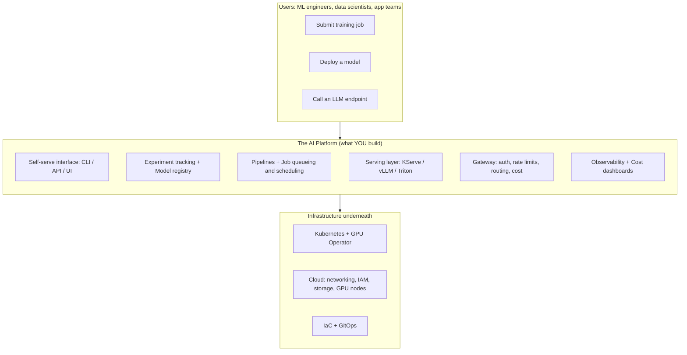
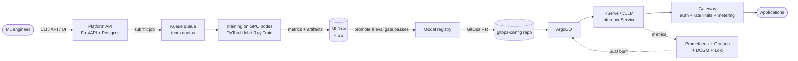

# 🛠️ AI Platform Engineer Roadmap

> A phase-wise, project-driven path from **ML student** to **AI Platform Engineer**: the person who builds the paved road that ML engineers use to train, ship, serve and operate models at scale.

**Last reviewed:** October 2026 · **Pace assumed:** 12–15 hrs/week · **Total duration:** ~12 months · **Starting point:** comfortable with Python and ML, new to Linux/infra/cloud

---

## 📑 Table of Contents

1. [What an AI Platform Engineer actually does](#1-what-an-ai-platform-engineer-actually-does)
2. [How to use this repo](#2-how-to-use-this-repo)
3. [How the video links work (read this)](#3-how-the-video-links-work-read-this)
4. [Roadmap at a glance](#4-roadmap-at-a-glance)
5. [Phase 0: Setup and mental model](#phase-0--setup-and-mental-model-week-0-1)
6. [Phase 1: Linux, shell and networking](#phase-1--linux-shell-and-networking-months-1-2)
7. [Phase 2: Production Python, Git and backend](#phase-2--production-python-git-and-backend-months-2-3)
8. [Phase 3: Docker and containers](#phase-3--docker-and-containers-month-3)
9. [Phase 4: Kubernetes](#phase-4--kubernetes-months-3-5)
10. [Phase 5: Cloud (AWS-first)](#phase-5--cloud-aws-first-months-4-6)
11. [Phase 6: IaC, CI/CD and GitOps](#phase-6--iac-cicd-and-gitops-months-5-7)
12. [Phase 7: Observability and SRE](#phase-7--observability-and-sre-months-6-8)
13. [Phase 8: ML lifecycle platform](#phase-8--ml-lifecycle-platform-months-7-9)
14. [Phase 9: Distributed training and GPU infrastructure](#phase-9--distributed-training-and-gpu-infrastructure-months-8-10)
15. [Phase 10: Model serving and LLMOps](#phase-10--model-serving-and-llmops-months-9-12)
16. [Phase 11: Capstone, security, FinOps and career](#phase-11--capstone-security-finops-and-career-months-11-12)
17. [Parallel track: ML systems fundamentals](#parallel-track--ml-systems-fundamentals)
18. [GSoC and open-source plan](#gsoc-and-open-source-plan)
19. [Certifications: which ones are worth it](#certifications-which-ones-are-worth-it)
20. [Weekly routine](#weekly-routine)
21. [Progress tracker](#progress-tracker)
22. [Interview preparation](#interview-preparation)
23. [Honest expectations](#honest-expectations)
24. [Master resource list](#master-resource-list)

---

## 1. What an AI Platform Engineer actually does

Your **customers are ML engineers and data scientists**. Your **product** is the internal platform they use so they never have to think about infrastructure.



### Where it sits among related roles

| Role | Main job | ML depth | Infra / DevOps / cloud depth |
|---|---|---|---|
| ML Engineer | Build, train, evaluate models | High | Low–Medium |
| MLOps Engineer | Automate train → deploy → monitor pipelines | Medium | High |
| **AI Platform Engineer** | Build the internal platform for training, serving, operating models | **Medium** | **Very high** |
| LLM / GenAI Platform Engineer | Same, specialised for LLM serving, gateways, RAG infra, evals | Medium | Very high |
| DevOps / SRE | Reliability and delivery of any software | Low | Very high |

**The sweet spot:** real infrastructure skill *plus* real understanding of what a model needs (GPU memory, batching, checkpoints, data throughput). Pure DevOps people usually lack the second half. Pure ML people usually lack the first. You are building both.

---

## 2. How to use this repo

1. **Fork or copy this README** into your own repo, e.g. `ai-platform-journey`.
2. **One folder per phase** (`phase-01-linux`, `phase-02-backend`, ...). Every phase ends with a **project**. Commit it there.
3. **Every project gets three artifacts:**
   - `README.md` with an architecture diagram and how to run it
   - `DECISIONS.md` explaining *why* you chose tool X over tool Y (platform engineering is judged on design decisions)
   - A short demo (screen recording or terminal GIF)
4. **Do not move on until the "Done when" checklist of a phase is true.**
5. **Rule of thumb for each topic:** learn it, break it on purpose, fix it, write down what you learned.

Suggested repo layout:

```text
ai-platform-journey/
├── README.md                  # this roadmap + your progress
├── phase-01-linux/
├── phase-02-backend/
├── phase-03-docker/
├── phase-04-kubernetes/
├── phase-05-cloud/
├── phase-06-iac-cicd/
├── phase-07-observability/
├── phase-08-ml-lifecycle/
├── phase-09-training-gpu/
├── phase-10-serving-llmops/
└── capstone-mini-ml-platform/
```

### Topic priority legend

| Tag | Meaning |
|---|---|
| 🔴 **Must** | You cannot do the job without it. Go deep. |
| 🟠 **Should** | Expected in most interviews and real work. Go to working level. |
| 🟢 **Later** | Valuable, but learn after the core is solid. |

---

## 3. How the video links work (read this)

YouTube videos get renamed, re-uploaded and deleted. To keep this roadmap honest, links are marked:

| Marker | Meaning |
|---|---|
| ✅ | **Direct link** taken from the publisher's own page (freeCodeCamp, DataTalks.Club, KodeKloud). Should open the exact video or playlist. |
| 🔎 | **YouTube search link** with a precise query plus the **channel/creator to prefer**. Always works, and always shows the freshest results. |
| 📘 | **Official documentation** or GitHub repo. |

> 💡 For fast-moving tools (vLLM, KServe, Kubeflow, Ray, Kueue), the **official docs beat any video older than ~12 months**. Use videos for concepts and walkthroughs, docs for exact commands.

---

## 4. Roadmap at a glance

| Phase | Focus | Time | Project (deliverable) | Outcome |
|---|---|---|---|---|
| 0 | Setup and mental model | Wk 0–1 | Repo + lab environment | Ready to work |
| 1 | Linux, shell, networking | Mo 1–2 | Hardened Linux server + bash toolkit | Comfortable in a terminal |
| 2 | Python, Git, backend | Mo 2–3 | Production-style model API + queue worker | Real service, not a notebook |
| 3 | Docker | Mo 3 | Optimised, GPU-ready ML image | Reproducible packaging |
| 4 | Kubernetes | Mo 3–5 | ML API on K8s with autoscaling | CKA-level skills |
| 5 | Cloud (AWS) | Mo 4–6 | Same app on managed K8s (EKS) | Cloud fluency |
| 6 | IaC, CI/CD, GitOps | Mo 5–7 | Everything provisioned and deployed from Git | Zero-click deploys |
| 7 | Observability, SRE | Mo 6–8 | Dashboards, alerts, SLOs, load test | Operable system |
| 8 | ML lifecycle | Mo 7–9 | Tracking + registry + pipeline | Reproducible ML |
| 9 | Training and GPU infra | Mo 8–10 | Queue-managed distributed training | Compute platform |
| 10 | Serving and LLMOps | Mo 9–12 | vLLM behind a gateway with autoscaling | Inference platform |
| 11 | Capstone and career | Mo 11–12 | Mini ML platform, end to end | Hireable portfolio |

Phases overlap by design (for example, cloud starts while you finish Kubernetes).

---

# 🧭 The Phases

---

## Phase 0 · Setup and mental model (Week 0–1)

### 🎯 Goal
Build the lab you will use for 12 months and understand the *shape* of the job before diving into tools.

### 📚 Topics

| Priority | Topic | Context: why it matters for AI platforms |
|---|---|---|
| 🔴 | Dev environment: Linux (native, dual boot or WSL2), VS Code, Git, SSH keys | Every later phase assumes a Linux shell |
| 🔴 | GitHub account, signed commits, a public portfolio repo | Your portfolio *is* your proof of skill |
| 🟠 | Free-tier cloud accounts (AWS / GCP) with **billing alerts set on day one** | GPUs and managed clusters are where surprise bills happen |
| 🟠 | Read the CNCF Cloud Native Landscape once, without memorising it | Gives you the map; you will not learn it all |
| 🟢 | Local compute options: Colab/Kaggle for GPU experiments, local `kind` or `minikube` for clusters | Practise without spending money |

### 🎬 Videos
- 🔎 **What is platform engineering?** → [search](https://www.youtube.com/results?search_query=what+is+platform+engineering+explained) (prefer CNCF, Nana, or conference talks)
- 🔎 **What does an MLOps / ML platform engineer do?** → [search](https://www.youtube.com/results?search_query=ML+platform+engineer+what+do+they+do)
- 🔎 **CNCF landscape explained** → [search](https://www.youtube.com/results?search_query=CNCF+cloud+native+landscape+explained)

### 🛠️ Project: "Lab zero"
Create the portfolio repo, set up SSH to GitHub, install Docker, `kubectl`, `kind`, `terraform` and `aws` CLI, and set **budget alarms** on every cloud account.

### ✅ Done when
- [ ] You can `git push` over SSH
- [ ] Billing alarms are active on every cloud account
- [ ] Your repo has the folder layout from section 2

---

## Phase 1 · Linux, shell and networking (Months 1–2)

### 🎯 Goal
Be fully comfortable operating a Linux machine and reasoning about how traffic flows between machines. Every GPU node, container and pod you meet later is just Linux with networking.

### 📚 Topics

| Priority | Topic | Context for AI platforms |
|---|---|---|
| 🔴 | Filesystem hierarchy, permissions, users and groups, `chmod`/`chown` | Container security and volume mounts depend on this |
| 🔴 | Processes and signals: `ps`, `top`/`htop`, `kill`, `nohup`, `systemd` units, `journalctl` | A training job dying with exit 137 (OOM kill) is a Linux concept |
| 🔴 | Shell scripting (bash): variables, loops, pipes, `grep`/`awk`/`sed`/`jq` | Glue code for every platform |
| 🔴 | SSH, key auth, `scp`/`rsync`, port forwarding, `tmux` | How you reach GPU boxes and debug nodes |
| 🔴 | Networking: TCP/IP, ports, DNS, HTTP/HTTPS, TLS, NAT, subnets and CIDR | Kubernetes networking, VPCs and load balancers are all built on this |
| 🔴 | Tools: `curl`, `dig`, `ss`/`netstat`, `ip`, `tcpdump` (basic), `traceroute` | First-response debugging |
| 🟠 | Package managers (`apt`), disk and memory inspection (`df`, `du`, `free`, `lsblk`) | Debugging full disks (model checkpoints fill disks fast) |
| 🟠 | Reverse proxy and load balancing with **nginx** | Direct ancestor of Ingress and API gateways |
| 🟠 | Firewalls (`ufw`/`iptables` concepts) | Security groups and NetworkPolicy are the same idea |
| 🟠 | Linux internals that matter for containers: **namespaces, cgroups** | This is literally what a container is |
| 🟢 | GPU on Linux: `nvidia-smi`, driver vs CUDA toolkit vs runtime | Prepares you for Phase 9 |

### 🎬 Videos
- ✅ **Linux crash course for beginners** (freeCodeCamp, ~3 hrs, covers install, terminal, files, networking, package manager) → https://youtu.be/ROjZy1WbCIA
- 🔎 **Bash scripting full course** → [search](https://www.youtube.com/results?search_query=bash+scripting+full+course+freeCodeCamp)
- 🔎 **Computer networking full course** → [search](https://www.youtube.com/results?search_query=computer+networking+full+course+freeCodeCamp)
- 🔎 **DNS explained (what really happens when you type a URL)** → [search](https://www.youtube.com/results?search_query=how+DNS+works+explained)
- 🔎 **TLS/HTTPS handshake explained** → [search](https://www.youtube.com/results?search_query=TLS+handshake+explained)
- 🔎 **nginx reverse proxy and load balancer tutorial** → [search](https://www.youtube.com/results?search_query=nginx+reverse+proxy+load+balancer+tutorial)
- 🔎 **What are Linux namespaces and cgroups? Containers from scratch** → [search](https://www.youtube.com/results?search_query=containers+from+scratch+namespaces+cgroups+Liz+Rice)
- 🔎 **CIDR and subnetting explained** → [search](https://www.youtube.com/results?search_query=CIDR+subnetting+explained)

### 📘 Docs and reading
- *The Linux Command Line* (William Shotts, free online)
- `man` pages: get used to reading them first

### 🛠️ Project: "Hardened server and toolkit"
1. Provision a small Ubuntu VM (local VirtualBox/Multipass, or a free-tier cloud VM).
2. Harden it: key-only SSH, non-root user, `ufw` rules, `fail2ban`.
3. Install nginx and put a tiny Python HTTP app behind it as a **systemd service** that restarts on failure.
4. Add TLS with a self-signed cert (or Let's Encrypt if you own a domain).
5. Write a **bash toolkit**: a health-check script, a log-rotation script and a `df`/memory alert script.
6. Deliberately break things (kill the app, fill the disk, block a port) and document how you diagnosed each.

**Deliverable:** `phase-01-linux/` with scripts, a diagram, and a `RUNBOOK.md` of the failures you caused and fixed.

### ✅ Done when
- [ ] You can explain what happens from typing a URL to the response arriving (DNS → TCP → TLS → HTTP)
- [ ] You can debug "service unreachable" using `ss`, `curl`, `dig` and logs
- [ ] You can explain a container in terms of namespaces and cgroups

---

## Phase 2 · Production Python, Git and backend (Months 2–3)

### 🎯 Goal
Move from notebooks to **services**. Platform engineers ship APIs, workers and tooling that other people depend on. This is your biggest gap if you come from an ML background, so give it real time.

### 📚 Topics

| Priority | Topic | Context for AI platforms |
|---|---|---|
| 🔴 | Production Python: packaging (`pyproject.toml`), virtual envs, typing, `pytest`, logging, config via env vars | Platform tooling must be testable and reproducible |
| 🔴 | **FastAPI**: routing, Pydantic, dependency injection, background tasks, async | The default framework for model-serving wrappers |
| 🔴 | REST design: status codes, idempotency, pagination, versioning | Your platform's API is a product |
| 🔴 | Git workflows: branching, rebase, PR review, conventional commits | Needed for GitOps and open-source contribution (GSoC) |
| 🟠 | **gRPC and Protobuf** | Triton and many serving stacks speak gRPC |
| 🟠 | Databases: PostgreSQL (schemas, indexes, transactions), Redis (cache, queues) | Metadata stores, job state, rate limiting |
| 🟠 | Async job processing: queues, workers, retries, dead-letter queues (Celery or RQ, then Kafka/RabbitMQ concepts) | Training and batch inference are async jobs |
| 🟠 | AuthN/AuthZ: API keys, JWT, OAuth2 basics, RBAC | Multi-tenant platform = who can run what |
| 🟠 | Distributed-systems basics: retries with backoff, timeouts, backpressure, idempotency, horizontal vs vertical scaling, CAP | Why serving systems fall over under load |
| 🟢 | **Go basics** | Kubernetes, Docker, Terraform and most operators are written in Go; reading it unlocks open-source contribution |
| 🟢 | Testing strategy: unit vs integration vs contract tests | Platform bugs are expensive |

### 🎬 Videos
- 🔎 **FastAPI full course** → [search](https://www.youtube.com/results?search_query=FastAPI+full+course+freeCodeCamp)
- 🔎 **Python packaging with pyproject.toml** → [search](https://www.youtube.com/results?search_query=python+packaging+pyproject.toml+tutorial)
- 🔎 **pytest tutorial for beginners** → [search](https://www.youtube.com/results?search_query=pytest+tutorial+for+beginners)
- 🔎 **PostgreSQL full course** → [search](https://www.youtube.com/results?search_query=PostgreSQL+full+course+freeCodeCamp)
- 🔎 **Redis crash course** → [search](https://www.youtube.com/results?search_query=Redis+crash+course)
- 🔎 **Celery with FastAPI and Redis** → [search](https://www.youtube.com/results?search_query=Celery+FastAPI+Redis+tutorial)
- 🔎 **gRPC crash course (Python)** → [search](https://www.youtube.com/results?search_query=gRPC+crash+course+python)
- 🔎 **JWT and OAuth2 explained** → [search](https://www.youtube.com/results?search_query=JWT+OAuth2+explained)
- 🔎 **Git and GitHub for beginners / advanced rebase** → [search](https://www.youtube.com/results?search_query=git+rebase+explained+advanced)
- 🔎 **System design basics: retries, backpressure, idempotency** → [search](https://www.youtube.com/results?search_query=system+design+idempotency+retries+backpressure)
- 🔎 **Go crash course for Python developers** → [search](https://www.youtube.com/results?search_query=Go+golang+full+course+freeCodeCamp)

### 🛠️ Project: "Model-as-a-service, the production way"
Build an API around an ML model you already trained (any classifier is fine):

- `POST /predict` (sync) and `POST /jobs` + `GET /jobs/{id}` (async) endpoints
- Redis/Celery worker for async inference; PostgreSQL for job records
- API-key authentication and per-key **rate limiting**
- Structured JSON logging, `/healthz` and `/readyz` endpoints, request IDs
- 80%+ test coverage with `pytest`, enforced in CI later
- `docker-compose.yml` that starts API + worker + Postgres + Redis

**Stretch:** expose the same model via **gRPC** and compare p95 latency against REST.

### ✅ Done when
- [ ] Your service survives `kill -9` of the worker without losing a job
- [ ] A retry of the same request does not create duplicate jobs (idempotency key)
- [ ] You can explain why `/healthz` and `/readyz` are different

---

## Phase 3 · Docker and containers (Month 3)

### 🎯 Goal
Package anything reproducibly, keep images small and secure, and run GPU workloads in containers.

### 📚 Topics

| Priority | Topic | Context for AI platforms |
|---|---|---|
| 🔴 | Images, layers, caching, registries, tags vs digests | ML images are huge; layer caching is the difference between 2-minute and 40-minute builds |
| 🔴 | Writing Dockerfiles: **multi-stage builds**, `.dockerignore`, non-root users, pinned versions | Security and image size |
| 🔴 | Volumes, bind mounts, networks, `docker compose` | Local multi-service ML stacks |
| 🔴 | Debugging: `logs`, `exec`, `inspect`, resource limits, exit codes (137 = OOM) | Daily work |
| 🟠 | **GPU containers**: NVIDIA Container Toolkit, CUDA base images, driver/CUDA/runtime compatibility | Foundation of everything in Phase 9–10 |
| 🟠 | Image scanning (Trivy), SBOMs, minimal bases (slim, distroless) | Supply-chain security for platforms |
| 🟠 | Model weights strategy: bake into the image vs mount from storage vs download on start | A core platform design decision; large weights break naive images |
| 🟢 | BuildKit, remote caches, Buildah/Podman as alternatives | Faster CI |
| 🟢 | OCI spec and how a runtime (containerd, runc) actually starts a container | Needed to debug node-level issues |

### 🎬 Videos
- ✅ **Docker and Kubernetes course** (freeCodeCamp: Amigoscode + TechWorld with Nana, ~4 hrs; Docker half covers images, volumes, Dockerfile, caching, tags, registry, inspect/logs/exec) → https://youtu.be/Wf2eSG3owoA
- 🔎 **Docker tutorial for beginners (TechWorld with Nana)** → [search](https://www.youtube.com/results?search_query=Docker+tutorial+for+beginners+TechWorld+with+Nana)
- 🔎 **Multi-stage builds and image size optimisation** → [search](https://www.youtube.com/results?search_query=docker+multi+stage+build+reduce+image+size)
- 🔎 **Docker Compose tutorial** → [search](https://www.youtube.com/results?search_query=docker+compose+tutorial+full)
- 🔎 **NVIDIA Container Toolkit: run GPU in Docker** → [search](https://www.youtube.com/results?search_query=NVIDIA+container+toolkit+docker+GPU+setup)
- 🔎 **Trivy container scanning tutorial** → [search](https://www.youtube.com/results?search_query=Trivy+container+image+scanning+tutorial)
- 🔎 **Docker best practices for production / Python** → [search](https://www.youtube.com/results?search_query=docker+best+practices+python+production)

### 📘 Docs
- 📘 Docker docs: https://docs.docker.com
- 📘 NVIDIA Container Toolkit docs (search "NVIDIA Container Toolkit install guide")

### 🛠️ Project: "The 400 MB ML image"
Containerize your Phase 2 service:

1. Baseline: naive single-stage Dockerfile. Record the size and build time.
2. Optimise with multi-stage builds, slim base, layer ordering, `.dockerignore`, non-root user.
3. Compare **three weight strategies**: baked in, volume-mounted, downloaded at startup. Measure cold-start time for each.
4. Scan with Trivy and fix high/critical findings.
5. Create a GPU variant (CUDA base image) and verify it runs `nvidia-smi` (Colab, a cloud GPU VM, or a local GPU).

**Deliverable:** a results table (size, build time, cold start, vulnerabilities before/after) plus a `DECISIONS.md` justifying your chosen weight strategy.

### ✅ Done when
- [ ] Image size and build time dropped measurably and you can show the numbers
- [ ] You can explain why layer order affects cache hits
- [ ] You can explain the driver vs CUDA toolkit vs container runtime relationship

---

## Phase 4 · Kubernetes (Months 3–5)

### 🎯 Goal
**This is the most important phase of the entire roadmap.** Kubernetes is the substrate on which almost every modern AI platform is built. Aim for CKA-level fluency.

### 📚 Topics

| Priority | Topic | Context for AI platforms |
|---|---|---|
| 🔴 | Architecture: control plane (API server, etcd, scheduler, controller manager), kubelet, kube-proxy, container runtime | Required to debug scheduling failures |
| 🔴 | Workloads: Pods, ReplicaSets, **Deployments**, **StatefulSets**, **Jobs**, **CronJobs**, DaemonSets | Serving = Deployments; training = Jobs; GPU drivers = DaemonSets |
| 🔴 | Services (ClusterIP, NodePort, LoadBalancer), **Ingress / Gateway API**, DNS inside the cluster | How model endpoints are exposed |
| 🔴 | ConfigMaps, Secrets, env injection | Model config, API keys |
| 🔴 | **Resource requests and limits**, QoS classes, OOMKilled, CPU throttling | GPU and memory sizing; the #1 cause of flaky ML pods |
| 🔴 | Scheduling: node selectors, affinity/anti-affinity, **taints and tolerations**, priority classes, preemption | Pinning workloads to GPU nodes and keeping others off them |
| 🔴 | Storage: PV, PVC, StorageClass, CSI | Datasets, checkpoints, model caches |
| 🔴 | Autoscaling: **HPA**, VPA concepts, Cluster Autoscaler, **Karpenter** (Phase 5/9) | Scaling inference with traffic |
| 🔴 | Probes: liveness, readiness, **startup probes** | Models take minutes to load; wrong probes cause restart loops |
| 🟠 | RBAC, ServiceAccounts, NetworkPolicy, Pod Security Standards | Multi-tenant platform security |
| 🟠 | **Helm** (charts, values, templating) and **Kustomize** | Packaging and promoting platform components |
| 🟠 | Troubleshooting: `describe`, `logs --previous`, events, `kubectl debug`, ephemeral containers | Interview favourite |
| 🟠 | **Operators, CRDs and controllers** | KServe, Kubeflow, Ray and Kueue are all operators; this is how platforms extend Kubernetes |
| 🟢 | Service mesh basics (Istio / Linkerd) | KServe and gateways often sit on it |
| 🟢 | Writing a basic operator in Go (kubebuilder) | Advanced; great for GSoC-style contributions |

### 🎬 Videos
- ✅ **Production-ready Kubernetes course** (freeCodeCamp, Saiyam Pathak, ~6 hrs: architecture, CRI/CNI/CSI, Gateway API, cert-manager, CloudNativePG, Prometheus and Grafana) → https://youtu.be/_4uQI4ihGVU
- ✅ **Docker + Kubernetes hands-on** (Kubernetes half covers pods, services, ingress, ConfigMaps, StatefulSets, minikube, debugging; Mongo + Mongo Express demo) → https://youtu.be/Wf2eSG3owoA
- 🔎 **Kubernetes tutorial for beginners, full course (TechWorld with Nana)** → [search](https://www.youtube.com/results?search_query=Kubernetes+tutorial+for+beginners+full+course+TechWorld+with+Nana)
- 🔎 **Kubernetes course for beginners (freeCodeCamp, Bogdan Stashchuk)** → [search](https://www.youtube.com/results?search_query=Kubernetes+course+full+beginners+tutorial+containerize+your+apps+freeCodeCamp)
- 🔎 **Kubernetes crash course with labs (KodeKloud)** → [search](https://www.youtube.com/results?search_query=KodeKloud+Kubernetes+crash+course)
- 🔎 **CKA exam preparation walkthrough** → [search](https://www.youtube.com/results?search_query=CKA+exam+preparation+full+course)
- 🔎 **Kubernetes requests, limits and OOMKilled explained** → [search](https://www.youtube.com/results?search_query=kubernetes+resource+requests+limits+OOMKilled+explained)
- 🔎 **Taints, tolerations and node affinity explained** → [search](https://www.youtube.com/results?search_query=kubernetes+taints+tolerations+node+affinity+explained)
- 🔎 **Helm tutorial for beginners** → [search](https://www.youtube.com/results?search_query=Helm+tutorial+for+beginners+kubernetes)
- 🔎 **Kubernetes Operators and CRDs explained** → [search](https://www.youtube.com/results?search_query=kubernetes+operators+CRD+explained)
- 🔎 **Build Kubernetes operators with Go and Kubebuilder (freeCodeCamp)** → [search](https://www.youtube.com/results?search_query=build+your+own+kubernetes+operators+go+kubebuilder+freeCodeCamp)
- 🔎 **Kubernetes troubleshooting: CrashLoopBackOff, Pending, ImagePullBackOff** → [search](https://www.youtube.com/results?search_query=kubernetes+troubleshooting+CrashLoopBackOff+Pending+pods)

### 📘 Docs
- 📘 Kubernetes docs and tutorials: https://kubernetes.io/docs/
- 📘 Kubernetes the Hard Way (do it once, for understanding): https://github.com/kelseyhightower/kubernetes-the-hard-way
- 📘 Killer.sh / CKA practice environment (paid; optional near the exam)

### 🛠️ Project: "Autoscaling ML API on Kubernetes"
Deploy your Phase 3 image on a local `kind` cluster, then a multi-node one:

1. Write plain manifests first (Deployment, Service, Ingress/Gateway, ConfigMap, Secret), then convert to a **Helm chart**.
2. Add correct **requests/limits, readiness, liveness and startup probes** (simulate a 60 s model load).
3. Add **HPA** on CPU; load test with **k6 or Locust** and watch pods scale.
4. Add a **taint** to one node and schedule the app only there with a toleration + node selector.
5. Add PVC-backed model cache so new pods do not redownload weights.
6. Break it on purpose: set memory too low (OOMKilled), wrong probe path, bad image tag. Document each failure signature.

**Deliverable:** Helm chart, load-test results (requests/s, p95, replica count over time), failure catalogue.

### ✅ Done when
- [ ] You can explain how a Pod gets scheduled, step by step, from `kubectl apply`
- [ ] You can fix a `Pending`, `CrashLoopBackOff` and `ImagePullBackOff` pod from events alone
- [ ] You pass practice CKA tasks inside the time limit (or sit the CKA)

---

## Phase 5 · Cloud (AWS-first) (Months 4–6)

### 🎯 Goal
Pick **one** cloud and go deep. AWS has the largest market share and job volume in India and globally; GCP is a good alternative with strong ML ergonomics. The concepts transfer, so depth in one beats shallow knowledge of three.

### 📚 Topics

| Priority | Topic | Context for AI platforms |
|---|---|---|
| 🔴 | **IAM**: users, roles, policies, least privilege, **IRSA** / workload identity for pods | The most common platform security mistake is over-broad IAM |
| 🔴 | **VPC**: subnets (public/private), route tables, internet and NAT gateways, security groups, NACLs | Where GPU nodes live and how they reach storage |
| 🔴 | Compute: EC2, instance families, **GPU instance types**, AMIs, Auto Scaling groups | GPU cost and availability drive platform design |
| 🔴 | Object storage: **S3** (buckets, lifecycle, versioning, presigned URLs, throughput patterns) | Datasets, checkpoints and model artifacts live here |
| 🔴 | **Managed Kubernetes (EKS)**: node groups, managed vs self-managed nodes, add-ons, load balancer controller | Where your Phase 4 skills go to production |
| 🟠 | Load balancers (ALB/NLB), Route 53, ACM certificates | Public endpoints for model APIs |
| 🟠 | **Spot instances**, interruption handling, capacity reservations, quotas and limit increases | 60–90% cost savings on training, but needs checkpointing |
| 🟠 | Managed ML services: SageMaker, Bedrock (or Vertex AI on GCP) | Know what you compete with and when buying beats building |
| 🟠 | Databases and queues in the cloud: RDS, ElastiCache, SQS | Managed versions of Phase 2 components |
| 🟠 | Cost tools: Cost Explorer, budgets, tagging strategy | Foundation of FinOps in Phase 11 |
| 🟢 | CloudWatch and cloud-native logging | Compare with Prometheus/Grafana |
| 🟢 | Multi-account setup (Organizations), SSO | How real companies are structured |

### 🎬 Videos
- 🔎 **AWS Certified Solutions Architect Associate full course (freeCodeCamp)** → [search](https://www.youtube.com/results?search_query=AWS+Certified+Solutions+Architect+Associate+full+course+freeCodeCamp)
- 🔎 **AWS IAM deep dive: roles, policies, least privilege** → [search](https://www.youtube.com/results?search_query=AWS+IAM+roles+policies+deep+dive)
- 🔎 **AWS VPC explained: subnets, NAT, route tables** → [search](https://www.youtube.com/results?search_query=AWS+VPC+explained+subnets+NAT+route+tables)
- 🔎 **AWS S3 tutorial: versioning, lifecycle, presigned URLs** → [search](https://www.youtube.com/results?search_query=AWS+S3+tutorial+lifecycle+presigned+urls)
- 🔎 **Amazon EKS full tutorial** → [search](https://www.youtube.com/results?search_query=Amazon+EKS+tutorial+full+course)
- 🔎 **IRSA: IAM roles for service accounts on EKS** → [search](https://www.youtube.com/results?search_query=EKS+IAM+roles+for+service+accounts+IRSA+explained)
- 🔎 **EC2 GPU instances for machine learning (P, G families)** → [search](https://www.youtube.com/results?search_query=AWS+EC2+GPU+instances+machine+learning+P4+G5)
- 🔎 **AWS spot instances for ML training** → [search](https://www.youtube.com/results?search_query=AWS+spot+instances+ML+training+checkpointing)
- 🔎 **SageMaker vs building your own platform** → [search](https://www.youtube.com/results?search_query=SageMaker+vs+kubernetes+MLOps+platform)
- 🔎 **GCP alternative: GKE + Vertex AI tutorial** → [search](https://www.youtube.com/results?search_query=GKE+Vertex+AI+tutorial)

### 📘 Docs
- 📘 AWS documentation: https://docs.aws.amazon.com
- 📘 EKS Best Practices Guide (search "EKS best practices guide")
- 📘 AWS Well-Architected Framework (search "AWS Well-Architected Framework")

### 🛠️ Project: "From laptop cluster to EKS"
Run the Phase 4 app on **EKS** (or GKE):

1. Create the cluster manually in the console **once** (learn what exists), then delete it.
2. Create private subnets, NAT, and a managed node group. Put nodes in private subnets.
3. Use **IRSA**: the pod reads a model from S3 with *no* static credentials.
4. Expose via an ALB with an ACM certificate and a Route 53 record (a cheap domain is worth it).
5. Add a **spot** node group for non-critical workloads.
6. Write a one-page **cost report**: monthly estimate for 1 CPU node group + 1 GPU node (on-demand vs spot).

> ⚠️ **Destroy everything after each session.** EKS control planes and NAT gateways bill by the hour.

### ✅ Done when
- [ ] You can draw your VPC from memory and explain every route
- [ ] A pod accesses S3 with zero secrets in manifests or env vars
- [ ] You can explain on-demand vs spot vs reserved for a training workload

---

## Phase 6 · IaC, CI/CD and GitOps (Months 5–7)

### 🎯 Goal
Nothing is created by hand. Infrastructure is code, deployments are pipelines, and Git is the single source of truth.

### 📚 Topics

| Priority | Topic | Context for AI platforms |
|---|---|---|
| 🔴 | **Terraform**: providers, resources, variables, outputs, **modules**, **remote state + locking**, workspaces, `plan`/`apply` discipline | Clusters, GPU node groups, buckets, IAM, all reproducible |
| 🔴 | **CI with GitHub Actions**: workflows, matrix builds, caching, secrets, OIDC to cloud (no long-lived keys) | Test, build, scan, push images automatically |
| 🔴 | CD pipeline design: environments (dev/staging/prod), promotion, rollback | Safe model-serving rollouts |
| 🔴 | **GitOps with ArgoCD (or Flux)**: app-of-apps, sync policies, drift detection, rollbacks | The standard way platforms are operated |
| 🟠 | Secrets management: External Secrets, Vault or cloud secret managers, **SOPS/sealed secrets** | Never put secrets in Git |
| 🟠 | Policy as code: OPA Gatekeeper or Kyverno | Enforce "no GPU requests without a quota label" |
| 🟠 | Terraform testing and linting: `tflint`, `checkov`, `terraform validate` | Catch misconfigurations before apply |
| 🟢 | Crossplane or Pulumi as alternatives | Awareness of other IaC models |
| 🟢 | Ansible for node configuration | Useful for bare-metal GPU fleets |
| 🟢 | Cluster API / cluster lifecycle | Advanced platform work |

### 🎬 Videos
- ✅ **Terraform course: automate your AWS cloud infrastructure** (freeCodeCamp, Sanjeev Thiyagarajan, ~2 hrs; state, variables, outputs, practice project) → https://www.youtube.com/watch?v=SLB_c_ayRMo
- ✅ **Terraform full course (KodeKloud, free version)** → https://www.youtube.com/watch?v=YcJ9IeukJL8
- 🔎 **Terraform and AWS dev environment (freeCodeCamp, Derek Morgan, ~2 hrs)** → [search](https://www.youtube.com/results?search_query=Learn+Terraform+and+AWS+by+building+a+dev+environment+freeCodeCamp)
- 🔎 **Terraform modules and remote state tutorial** → [search](https://www.youtube.com/results?search_query=terraform+modules+remote+state+s3+locking+tutorial)
- 🔎 **Terraform EKS cluster tutorial** → [search](https://www.youtube.com/results?search_query=terraform+EKS+cluster+tutorial)
- 🔎 **GitHub Actions full course / CI/CD pipeline** → [search](https://www.youtube.com/results?search_query=GitHub+Actions+full+course+CI+CD+pipeline)
- 🔎 **GitHub Actions OIDC to AWS (no access keys)** → [search](https://www.youtube.com/results?search_query=GitHub+Actions+OIDC+AWS+no+access+keys)
- 🔎 **ArgoCD tutorial for beginners (TechWorld with Nana)** → [search](https://www.youtube.com/results?search_query=ArgoCD+tutorial+for+beginners+GitOps+TechWorld+with+Nana)
- 🔎 **GitOps explained: ArgoCD vs Flux** → [search](https://www.youtube.com/results?search_query=GitOps+ArgoCD+vs+Flux+explained)
- 🔎 **External Secrets Operator / Vault on Kubernetes** → [search](https://www.youtube.com/results?search_query=External+Secrets+Operator+Vault+kubernetes+tutorial)
- 🔎 **Kyverno or OPA Gatekeeper policy tutorial** → [search](https://www.youtube.com/results?search_query=Kyverno+policy+tutorial+kubernetes)

### 📘 Docs
- 📘 Terraform docs and tutorials: https://developer.hashicorp.com/terraform
- 📘 ArgoCD docs: https://argo-cd.readthedocs.io
- 📘 GitHub Actions docs: https://docs.github.com/actions

### 🛠️ Project: "Everything from Git"
1. Terraform modules for: VPC, EKS, GPU/spot node groups, S3 buckets, IAM roles. Remote state in S3 with locking.
2. GitHub Actions pipeline: lint → test → build → **Trivy scan** → push to registry → bump image tag in the GitOps repo. Authenticate to AWS using **OIDC**.
3. **ArgoCD** watches a separate `gitops-config` repo and syncs the Helm release.
4. Demo: change the replica count in Git → cluster converges without touching `kubectl`. Roll back with `git revert`.
5. Add Kyverno policy: reject pods without resource limits.
6. Demonstrate **drift detection**: change something by hand and watch ArgoCD revert it.

**Deliverable:** two repos (`infra`, `gitops-config`), a pipeline diagram, and a 2-minute recording of git-push-to-production.

### ✅ Done when
- [ ] `terraform destroy` followed by `terraform apply` rebuilds your whole environment
- [ ] No long-lived cloud credentials exist anywhere in GitHub secrets
- [ ] A bad deploy is rolled back with a single `git revert`

---

## Phase 7 · Observability and SRE (Months 6–8)

### 🎯 Goal
If you cannot measure it, you cannot operate it. For AI platforms, observability must include **GPU utilisation, queue depth, tokens per second and cost**, not just CPU and HTTP errors.

### 📚 Topics

| Priority | Topic | Context for AI platforms |
|---|---|---|
| 🔴 | **Prometheus**: metric types, PromQL, scraping, ServiceMonitors, recording and alerting rules | Standard metrics layer; vLLM and Triton export Prometheus metrics |
| 🔴 | **Grafana** dashboards and alerting | The window users see into the platform |
| 🔴 | **SLIs, SLOs, SLAs, error budgets** | Defines "healthy" for a model endpoint (for example, p95 < 800 ms) |
| 🔴 | Alerting without noise: symptom-based alerts, severity, runbooks | On-call sanity |
| 🟠 | Logs: Loki or ELK; structured logging | Debug failed training jobs |
| 🟠 | Tracing: **OpenTelemetry**, Jaeger or Tempo | Follow a request: gateway → router → model server |
| 🟠 | **GPU observability: NVIDIA DCGM exporter** (GPU util, memory, temp, power, XID errors) | Idle GPUs are the most expensive waste |
| 🟠 | Incident response: severity levels, comms, **blameless postmortems** | Real platform teams live by this |
| 🟠 | Load and chaos testing: k6, Locust, basic chaos (kill pods, drain nodes) | Prove the platform survives failure |
| 🟢 | ML-specific monitoring: data drift, prediction drift, model quality (Evidently, WhyLabs concepts) | Bridges platform and ML |
| 🟢 | Capacity planning and saturation analysis (USE and RED methods) | Interview favourite |

### 🎬 Videos
- ✅ **Production-ready Kubernetes** includes the full Prometheus + Grafana observability demo at the end → https://youtu.be/_4uQI4ihGVU
- 🔎 **Prometheus and Grafana tutorial (TechWorld with Nana)** → [search](https://www.youtube.com/results?search_query=Prometheus+monitoring+tutorial+TechWorld+with+Nana)
- 🔎 **PromQL tutorial: rate, histogram_quantile, aggregations** → [search](https://www.youtube.com/results?search_query=PromQL+tutorial+rate+histogram_quantile)
- 🔎 **kube-prometheus-stack on Kubernetes with Helm** → [search](https://www.youtube.com/results?search_query=kube-prometheus-stack+helm+tutorial)
- 🔎 **SLI, SLO, error budgets explained (Google SRE)** → [search](https://www.youtube.com/results?search_query=SLI+SLO+SLA+error+budget+explained+Google+SRE)
- 🔎 **OpenTelemetry crash course** → [search](https://www.youtube.com/results?search_query=OpenTelemetry+crash+course+traces+metrics+logs)
- 🔎 **Loki and Grafana logging tutorial** → [search](https://www.youtube.com/results?search_query=Grafana+Loki+tutorial+kubernetes+logs)
- 🔎 **NVIDIA DCGM exporter GPU monitoring Prometheus Grafana** → [search](https://www.youtube.com/results?search_query=NVIDIA+DCGM+exporter+GPU+monitoring+Prometheus+Grafana)
- 🔎 **k6 load testing tutorial** → [search](https://www.youtube.com/results?search_query=k6+load+testing+tutorial)
- 🔎 **How to write a blameless postmortem** → [search](https://www.youtube.com/results?search_query=blameless+postmortem+how+to+write+SRE)

### 📘 Docs and reading
- 📘 Prometheus docs: https://prometheus.io/docs/
- 📘 *Site Reliability Engineering* (Google, free online): https://sre.google/books/

### 🛠️ Project: "Operable ML API"
Instrument the Phase 6 deployment:

1. Install `kube-prometheus-stack` via ArgoCD.
2. Expose **custom app metrics**: request count, latency histogram, queue depth, model-load time, prediction-class distribution.
3. Build Grafana dashboards using **RED** (rate, errors, duration) for the API and **USE** (utilisation, saturation, errors) for nodes.
4. Define an **SLO** (for example, 99% of requests < 500 ms over 30 days) with a burn-rate alert.
5. Add Loki for logs and OpenTelemetry tracing across API → worker.
6. Run a k6 load test and a **chaos drill** (kill a pod, drain a node) and write a **postmortem** as if it were production.

**Deliverable:** dashboard JSON in Git, alert rules in Git, and one real postmortem document.

### ✅ Done when
- [ ] You can answer "is this service healthy?" from one dashboard in under 30 seconds
- [ ] An alert fires, links to a runbook, and the runbook actually fixes the issue
- [ ] You have written at least one postmortem

---

## Phase 8 · ML lifecycle platform (Months 7–9)

### 🎯 Goal
This is where you stop being "DevOps who knows Docker" and become an **ML** platform engineer. Make ML work reproducible, trackable, versioned and automated.

### 📚 Topics

| Priority | Topic | Context for AI platforms |
|---|---|---|
| 🔴 | **Experiment tracking**: MLflow or Weights & Biases (params, metrics, artifacts, comparisons) | Every ML team needs it; you operate it |
| 🔴 | **Model registry**: versions, stages/aliases, lineage, approvals | The contract between training and serving |
| 🔴 | **Data and model versioning**: DVC, lakeFS, or Delta/Iceberg time-travel | Reproducibility: "which data trained this model?" |
| 🔴 | **Pipeline orchestration**: Airflow, then **Kubeflow Pipelines**, Argo Workflows or Flyte | Turns notebooks into repeatable DAGs |
| 🟠 | Running MLflow in production: Postgres backend, S3 artifact store, auth, backup | A real platform service with real ops |
| 🟠 | **Feature stores**: Feast (offline vs online, point-in-time correctness, training/serving skew) | Prevents the most subtle ML bugs |
| 🟠 | Data formats and processing: Parquet, Arrow, Spark basics, Delta/Iceberg | Training throughput is often a data problem |
| 🟠 | CI for ML: data validation (Great Expectations / Pandera), model tests, evaluation gates | Block bad models before deploy |
| 🟠 | Reproducibility: pinned environments, seeds, containerised training | Audit and debugging |
| 🟢 | Metadata and lineage standards (OpenLineage) | Governance in large orgs |
| 🟢 | Notebook infrastructure (JupyterHub on Kubernetes) | A very common first platform product |

### 🎬 Videos
- ✅ **MLOps Zoomcamp (DataTalks.Club): full free course playlist** covering experiment tracking, orchestration, deployment, monitoring, best practices → https://www.youtube.com/playlist?list=PL3MmuxUbc_hIUISrluw_A7wDSmfOhErJK
- 📘 **MLOps Zoomcamp materials and homework** → https://github.com/DataTalksClub/mlops-zoomcamp
- 🔎 **MLflow tutorial: tracking and model registry** → [search](https://www.youtube.com/results?search_query=MLflow+tutorial+tracking+model+registry)
- 🔎 **Run MLflow on Kubernetes with Postgres and S3** → [search](https://www.youtube.com/results?search_query=MLflow+kubernetes+postgres+S3+deployment)
- 🔎 **DVC tutorial: data versioning** → [search](https://www.youtube.com/results?search_query=DVC+data+version+control+tutorial)
- 🔎 **Airflow tutorial for beginners** → [search](https://www.youtube.com/results?search_query=Apache+Airflow+tutorial+for+beginners+full+course)
- 🔎 **Kubeflow Pipelines tutorial** → [search](https://www.youtube.com/results?search_query=Kubeflow+Pipelines+tutorial)
- 🔎 **Argo Workflows tutorial** → [search](https://www.youtube.com/results?search_query=Argo+Workflows+tutorial+kubernetes)
- 🔎 **Flyte for ML pipelines intro** → [search](https://www.youtube.com/results?search_query=Flyte+ML+pipelines+tutorial)
- 🔎 **Feast feature store tutorial** → [search](https://www.youtube.com/results?search_query=Feast+feature+store+tutorial)
- 🔎 **Great Expectations data validation tutorial** → [search](https://www.youtube.com/results?search_query=Great+Expectations+data+validation+tutorial)
- 🔎 **JupyterHub on Kubernetes (Zero to JupyterHub)** → [search](https://www.youtube.com/results?search_query=JupyterHub+kubernetes+zero+to+jupyterhub)

### 📘 Docs and learning
- 📘 MLflow: https://mlflow.org/docs/latest/
- 📘 Kubeflow: https://www.kubeflow.org/docs/
- 📘 Made With ML (end-to-end ML engineering, free): https://madewithml.com
- 📘 Chip Huyen, *Designing Machine Learning Systems* (book; the best conceptual overview)

### 🛠️ Project: "Train → track → register → promote"
1. Deploy **MLflow** on your cluster (Postgres backend, S3 artifact store) via Helm + ArgoCD.
2. Version the dataset with DVC (or lakeFS) backed by S3.
3. Build a **pipeline** (Argo Workflows, Kubeflow Pipelines or Flyte): validate data → train → evaluate → register model.
4. Add an **evaluation gate**: the model is promoted only if it beats the current production model on a held-out set.
5. Every registered model must link to: Git commit, data version, container image digest, metrics.

**Deliverable:** pipeline code, MLflow running in-cluster, and a diagram showing lineage from dataset to deployed model.

### ✅ Done when
- [ ] Given any production model, you can trace its exact code, data and environment
- [ ] A bad model is automatically blocked from promotion
- [ ] Someone else can rerun your pipeline from a fresh clone and get the same result

---

## Phase 9 · Distributed training and GPU infrastructure (Months 8–10)

### 🎯 Goal
Understand how large training jobs actually run, and build the compute layer that schedules GPUs fairly and efficiently. This is the phase that separates AI platform engineers from generic DevOps.

### 📚 Topics

| Priority | Topic | Context for AI platforms |
|---|---|---|
| 🔴 | **GPU basics**: memory hierarchy, why VRAM is the constraint, FP32/FP16/BF16/INT8, utilisation vs memory | Everything else follows from this |
| 🔴 | **Memory math**: weights + gradients + optimiser states + activations; why a 7B model needs far more than 14 GB to train | Capacity planning |
| 🔴 | **Data parallelism (DDP)**, then **FSDP/ZeRO** (sharding), tensor and pipeline parallelism (concepts) | Why jobs need multiple GPUs and how they talk |
| 🔴 | **Checkpointing and fault tolerance**: save/resume, spot interruption, elastic training | A node *will* die mid-run |
| 🔴 | **GPU on Kubernetes**: NVIDIA device plugin, **NVIDIA GPU Operator**, resource requests like `nvidia.com/gpu` | How pods get GPUs |
| 🔴 | **Job queueing and fair sharing**: **Kueue** (or Volcano / YuniKorn), quotas, priorities, preemption, **gang scheduling** | Without this, one team hogs the cluster |
| 🟠 | **Ray** (Core, Train, Data, Tune) and **KubeRay** | The most popular distributed compute layer for ML on Kubernetes |
| 🟠 | **Kubeflow Training Operator** (PyTorchJob) | Declarative distributed training jobs |
| 🟠 | GPU sharing: **MIG**, time-slicing, MPS | Packing many small jobs onto big GPUs |
| 🟠 | Node autoscaling for GPUs: **Karpenter** or Cluster Autoscaler, warm pools | Scale GPU nodes to zero when idle |
| 🟠 | Networking for training: NCCL, InfiniBand/EFA, topology awareness (concepts) | Multi-node training speed |
| 🟠 | Storage throughput: shared filesystems (FSx for Lustre, etc.), dataset streaming, caching | Starved GPUs are wasted GPUs |
| 🟢 | DeepSpeed and Megatron concepts | You will meet these in LLM training |
| 🟢 | Bare-metal GPU cluster ops, Slurm vs Kubernetes | Common in research-heavy orgs |

### 🎬 Videos
- 🔎 **GPU memory math for LLM training explained** → [search](https://www.youtube.com/results?search_query=GPU+memory+math+LLM+training+explained+weights+gradients+optimizer+states)
- 🔎 **PyTorch DDP tutorial (official PyTorch series)** → [search](https://www.youtube.com/results?search_query=PyTorch+DistributedDataParallel+tutorial+series)
- 🔎 **FSDP explained (PyTorch)** → [search](https://www.youtube.com/results?search_query=PyTorch+FSDP+explained+tutorial)
- 🔎 **ZeRO and DeepSpeed explained** → [search](https://www.youtube.com/results?search_query=DeepSpeed+ZeRO+explained)
- 🔎 **Data, tensor and pipeline parallelism explained** → [search](https://www.youtube.com/results?search_query=data+parallelism+tensor+parallelism+pipeline+parallelism+explained)
- 🔎 **NVIDIA GPU Operator on Kubernetes install** → [search](https://www.youtube.com/results?search_query=NVIDIA+GPU+Operator+kubernetes+install+tutorial)
- 🔎 **Kueue tutorial: job queueing on Kubernetes** → [search](https://www.youtube.com/results?search_query=Kueue+kubernetes+job+queueing+tutorial)
- 🔎 **Gang scheduling and Volcano on Kubernetes** → [search](https://www.youtube.com/results?search_query=Volcano+gang+scheduling+kubernetes+AI)
- 🔎 **Ray Train / KubeRay tutorial** → [search](https://www.youtube.com/results?search_query=KubeRay+Ray+Train+kubernetes+tutorial)
- 🔎 **Ray crash course (Anyscale)** → [search](https://www.youtube.com/results?search_query=Ray+distributed+computing+crash+course+Anyscale)
- 🔎 **Kubeflow Training Operator PyTorchJob** → [search](https://www.youtube.com/results?search_query=Kubeflow+Training+Operator+PyTorchJob+tutorial)
- 🔎 **MIG vs time-slicing GPU sharing** → [search](https://www.youtube.com/results?search_query=NVIDIA+MIG+vs+time+slicing+GPU+sharing+kubernetes)
- 🔎 **Karpenter tutorial for GPU nodes** → [search](https://www.youtube.com/results?search_query=Karpenter+tutorial+GPU+nodes+autoscaling)

### 📘 Docs
- 📘 Ray docs: https://docs.ray.io
- 📘 Kueue: https://kueue.sigs.k8s.io
- 📘 NVIDIA GPU Operator docs (search "NVIDIA GPU Operator documentation")
- 📘 PyTorch distributed docs: https://pytorch.org/docs/stable/distributed.html
- 📘 Hugging Face "Ultra-Scale Playbook" (search the title): excellent free guide on parallelism

### 🛠️ Project: "Shared GPU cluster with fair queueing"
1. Provision a cluster with a GPU node group (use cheap GPU instances, spot where possible; or a single-GPU dev box with `kind`/`k3s`).
2. Install the **GPU Operator** and verify with a `nvidia-smi` pod.
3. Run a small PyTorch **DDP** job (even 2 processes on 1 GPU or 2 small GPUs) as a **PyTorchJob** or a **Ray Train** job.
4. Install **Kueue**: create two "teams" with quotas, priorities and borrowing. Submit competing jobs and show fair sharing and **preemption**.
5. Implement **checkpoint-and-resume**: kill a worker pod mid-training; training resumes from the last checkpoint.
6. Scale GPU nodes to zero when idle (Karpenter or Cluster Autoscaler) and prove it with a cost graph.
7. Expose DCGM metrics to Grafana: GPU utilisation per team.

**Deliverable:** a "compute platform" README with architecture, quota policy, a recorded preemption demo and a GPU-utilisation dashboard.

### ✅ Done when
- [ ] You can estimate training memory for a given model size and choose a parallelism strategy
- [ ] Two teams share a cluster fairly and you can show the evidence
- [ ] A killed training pod resumes automatically without losing more than N minutes of work

---

## Phase 10 · Model serving and LLMOps (Months 9–12)

### 🎯 Goal
Run models for real users at acceptable latency and cost. In 2026 this largely means **LLM inference platforms**: serving engines, gateways, autoscaling, evals and guardrails.

### 📚 Topics

| Priority | Topic | Context for AI platforms |
|---|---|---|
| 🔴 | **Inference fundamentals**: prefill vs decode, **KV cache**, memory-bound vs compute-bound, TTFT, inter-token latency, throughput vs latency | The vocabulary of every serving discussion |
| 🔴 | **vLLM**: PagedAttention, **continuous batching**, prefix caching, OpenAI-compatible server, tensor parallel serving, key flags (`--max-model-len`, `--gpu-memory-utilization`, `--tensor-parallel-size`) | The most widely used open serving engine |
| 🔴 | **Quantisation**: INT8/INT4, AWQ, GPTQ, FP8; accuracy vs cost trade-offs | Often 2–4x cost reduction |
| 🔴 | **Autoscaling inference**: scale on queue depth, concurrency or GPU metrics (not CPU), KEDA, scale-to-zero trade-offs, cold starts | Where platform engineering meets ML |
| 🔴 | **Deployment strategies**: canary, shadow, A/B, blue-green; safe model rollouts | Models regress silently; rollouts must be reversible |
| 🟠 | **KServe** (InferenceService, serving runtimes, autoscaling, transformer/explainer pattern) | The Kubernetes-native model-serving standard |
| 🟠 | **vLLM Production Stack**, llm-d, or similar: routers, KV-cache-aware routing, multi-replica serving | How people scale vLLM on Kubernetes |
| 🟠 | **NVIDIA Triton** and TensorRT-LLM (concepts; hands-on if you have the GPU) | Multi-framework, high-performance serving |
| 🟠 | Other engines to compare: **SGLang**, TGI, Ollama (dev only), BentoML | Know trade-offs, not just one tool |
| 🟠 | **LLM gateway**: LiteLLM or similar: auth, per-team keys, rate limits, budgets, routing, fallbacks, usage metering | The front door of an LLM platform |
| 🟠 | **RAG infrastructure**: vector DBs (Qdrant, pgvector, Milvus), embedding services, ingestion pipelines, caching | Most enterprise LLM apps are RAG |
| 🟠 | **Evals and guardrails**: offline eval pipelines, regression suites, LLM-as-judge caveats, PII filters, prompt-injection defences | You cannot ship what you cannot evaluate |
| 🟠 | **Speculative decoding, disaggregated prefill/decode, LoRA multi-adapter serving** | Modern optimisation techniques |
| 🟢 | Model-weight distribution: caching on node, `ModelCar`/OCI artifacts, fast loaders | Cold start is a real production issue |
| 🟢 | Edge and on-device inference | Different constraints |

### 🎬 Videos
- 🔎 **vLLM explained: PagedAttention and continuous batching** → [search](https://www.youtube.com/results?search_query=vLLM+PagedAttention+continuous+batching+explained)
- 🔎 **Deploy an LLM with vLLM (hands-on)** → [search](https://www.youtube.com/results?search_query=vLLM+tutorial+deploy+LLM+OpenAI+compatible+server)
- 🔎 **vLLM on Kubernetes** → [search](https://www.youtube.com/results?search_query=vLLM+kubernetes+deployment+production+stack)
- 🔎 **KV cache explained** → [search](https://www.youtube.com/results?search_query=LLM+KV+cache+explained)
- 🔎 **LLM inference optimisation: quantisation, batching, speculative decoding** → [search](https://www.youtube.com/results?search_query=LLM+inference+optimization+quantization+speculative+decoding+explained)
- 🔎 **AWQ vs GPTQ vs FP8 quantisation** → [search](https://www.youtube.com/results?search_query=AWQ+vs+GPTQ+vs+FP8+quantization+LLM)
- 🔎 **KServe tutorial: InferenceService on Kubernetes** → [search](https://www.youtube.com/results?search_query=KServe+tutorial+InferenceService+kubernetes)
- 🔎 **KServe with vLLM / LLM serving runtime** → [search](https://www.youtube.com/results?search_query=KServe+LLM+vLLM+serving+runtime)
- 🔎 **KEDA autoscaling on custom metrics** → [search](https://www.youtube.com/results?search_query=KEDA+autoscaling+tutorial+kubernetes+prometheus)
- 🔎 **NVIDIA Triton Inference Server tutorial** → [search](https://www.youtube.com/results?search_query=NVIDIA+Triton+Inference+Server+tutorial)
- 🔎 **LiteLLM proxy gateway tutorial** → [search](https://www.youtube.com/results?search_query=LiteLLM+proxy+gateway+tutorial+virtual+keys+budgets)
- 🔎 **Canary and shadow deployments for ML models** → [search](https://www.youtube.com/results?search_query=canary+shadow+deployment+ML+models+explained)
- 🔎 **RAG infrastructure with Qdrant / pgvector** → [search](https://www.youtube.com/results?search_query=RAG+pipeline+Qdrant+pgvector+production)
- 🔎 **LLM evaluation pipelines (RAGAS, DeepEval, promptfoo)** → [search](https://www.youtube.com/results?search_query=LLM+evaluation+RAGAS+DeepEval+promptfoo+tutorial)
- 🔎 **LLM guardrails and prompt injection defence** → [search](https://www.youtube.com/results?search_query=LLM+guardrails+prompt+injection+defense+tutorial)
- ✅ **LLM Zoomcamp (DataTalks.Club)**: free course on building RAG and LLM apps → repo: https://github.com/DataTalksClub/llm-zoomcamp (videos are linked from its README)

### 📘 Docs and repos
- 📘 vLLM docs: https://docs.vllm.ai
- 📘 vLLM on Kubernetes: https://docs.vllm.ai/en/latest/deployment/k8s/
- 📘 **vLLM Production Stack** (Helm chart, router, observability): https://github.com/vllm-project/production-stack
- 📘 KServe: https://kserve.github.io/website/
- 📘 NVIDIA Triton docs (search "NVIDIA Triton Inference Server documentation")
- 📘 Anyscale blog on continuous batching (search "How continuous batching enables 23x throughput")

### 🛠️ Project A: "Self-hosted LLM endpoint"
1. Serve a small open model (a 1–8B Qwen, Llama or Mistral-class model) with **vLLM** on a single GPU node on Kubernetes.
2. Put **LiteLLM** (or your own FastAPI gateway) in front: API keys per team, rate limits, usage metering.
3. Expose Prometheus metrics (vLLM already provides them) and build a dashboard: tokens/s, TTFT, queue depth, GPU memory, KV-cache usage.
4. **Benchmark** at 1, 8, 32, 64 concurrent users: tokens/s, TTFT, p95 latency. Compare FP16 vs an INT4/AWQ build, and different `--max-model-len` and batching settings.
5. Autoscale replicas on **queue depth / concurrency** using KEDA (or HPA with custom metrics).
6. Write the cost model: **cost per million tokens** at your measured throughput.

**Deliverable:** benchmark report with charts, a cost-per-token table, and the architecture diagram.

### 🛠️ Project B: "Model serving platform with safe rollouts"
1. Install **KServe**; deploy a classical ML model and an LLM runtime as `InferenceService`s.
2. Implement a **canary rollout** (10% → 50% → 100%) driven by Argo Rollouts, KServe canary or traffic splitting.
3. Add automated rollback when the error rate or latency SLO burns.
4. Add a **shadow deployment** that mirrors traffic to a candidate model and logs differences.

### 🛠️ Project C (stretch): "RAG as a platform service"
Take any RAG app you have already built and **platformise** it: ingestion pipeline as an Argo/Kubeflow workflow, vector DB (Qdrant or pgvector) deployed via Helm, embedding service, eval suite in CI that blocks regressions, per-tenant isolation.

### ✅ Done when
- [ ] You can explain why decode is memory-bound and what the KV cache costs per request
- [ ] You can show a benchmark and justify a quantisation or batching choice with numbers
- [ ] A bad model version is rolled back automatically by an SLO-driven rule
- [ ] You can state cost per million tokens for your setup and one way to cut it by 30%

---

## Phase 11 · Capstone, security, FinOps and career (Months 11–12)

### 🏁 Capstone: "Mini ML Platform"

Combine everything into one self-serve platform. This single project, well documented, is worth more than ten certificates.



**Required capabilities**
1. **Submit** a training job through your API/CLI (YAML spec in, job out).
2. **Queue and schedule** it on GPU nodes with per-team quotas (Kueue).
3. **Track** metrics and artifacts in MLflow; register the model.
4. **Gate**: promote only if evaluation beats the baseline.
5. **Deploy** automatically via GitOps to a KServe or vLLM endpoint behind a gateway with auth and rate limits.
6. **Observe**: dashboards for GPU use, latency, tokens/s, cost per team; SLO alerts.
7. **Roll back** automatically on SLO burn.
8. **Everything as code**: Terraform for infra, Helm/ArgoCD for apps, GitHub Actions for CI, one-command bootstrap.

**Documentation (as important as the code)**
- Architecture diagram and a "why these tools" `DECISIONS.md`
- A **Getting Started for a new ML engineer** guide (this is your "customer" documentation)
- A runbook and 2 postmortems from failures you provoked
- A 5-minute demo video

### 🔐 Security essentials (weave into the capstone)

| Priority | Topic |
|---|---|
| 🔴 | Least-privilege IAM, no long-lived credentials, secrets never in Git |
| 🔴 | Namespace isolation, RBAC, NetworkPolicy, Pod Security Standards for multi-tenancy |
| 🟠 | Image signing and verification (cosign), SBOMs, admission policies |
| 🟠 | Model supply-chain risks: untrusted weights, pickle deserialisation, `safetensors` |
| 🟠 | LLM-specific: prompt injection, data exfiltration through tools, PII handling, audit logs |
| 🟢 | Compliance basics (SOC 2 / ISO 27001 vocabulary) |

🔎 Videos: [Kubernetes security best practices](https://www.youtube.com/results?search_query=kubernetes+security+best+practices+RBAC+network+policy) · [cosign image signing](https://www.youtube.com/results?search_query=cosign+sigstore+image+signing+tutorial) · [pickle vs safetensors model security](https://www.youtube.com/results?search_query=safetensors+vs+pickle+model+security)

### 💰 FinOps for AI

| Priority | Topic |
|---|---|
| 🔴 | **Cost per training run, per 1M tokens, per request** | 
| 🔴 | GPU utilisation targets; finding idle GPUs; scale-to-zero |
| 🟠 | Spot vs on-demand vs reserved/savings plans; right-sizing; MIG packing |
| 🟠 | Showback/chargeback per team (labels, OpenCost/Kubecost) |
| 🟠 | Quantisation, caching (prefix and semantic) and batching as cost levers |

🔎 Videos: [OpenCost / Kubecost tutorial](https://www.youtube.com/results?search_query=OpenCost+Kubecost+kubernetes+cost+monitoring+tutorial) · [FinOps for GPUs and AI](https://www.youtube.com/results?search_query=FinOps+GPU+AI+workloads+cost+optimization)

### ✅ Done when
- [ ] A new person can follow your docs and submit a job, then call the deployed model, without asking you anything
- [ ] You can defend every tool choice with a trade-off
- [ ] Your repo has diagrams, benchmarks, a demo, runbooks and postmortems

---

## 🧠 Parallel track · ML systems fundamentals

Study these **alongside** Phases 8–10. They are the "AI" in AI platform engineer. Do 2–3 hours a week.

| Concept | You should be able to explain |
|---|---|
| Transformer architecture (high level) | Attention, why context length costs memory, why decode is sequential |
| Training memory | Weights + grads + optimiser states + activations; mixed precision; activation checkpointing |
| Inference memory | Weights + **KV cache** (grows with batch × sequence length); why long contexts are expensive |
| Roofline thinking | Compute-bound vs memory-bandwidth-bound; why batching improves throughput |
| Parallelism | Data, tensor, pipeline, sequence/context, expert parallelism and their communication costs |
| Numerical formats | FP32, BF16, FP16, FP8, INT8, INT4; accuracy trade-offs |
| Metrics | Throughput, latency (TTFT, ITL, E2E), goodput, utilisation, MFU |
| Failure modes | OOM, NCCL hangs, stragglers, silent data corruption, checkpoint corruption |

### 🎬 Videos
- 🔎 **Andrej Karpathy: "Let's build GPT" and "Intro to LLMs"** → [search](https://www.youtube.com/results?search_query=Andrej+Karpathy+Let%27s+build+GPT+from+scratch)
- 🔎 **3Blue1Brown: transformers and attention (visual)** → [search](https://www.youtube.com/results?search_query=3Blue1Brown+transformers+attention+explained)
- 🔎 **How GPUs work for deep learning (memory bandwidth, roofline)** → [search](https://www.youtube.com/results?search_query=GPU+architecture+deep+learning+memory+bandwidth+roofline+explained)
- 🔎 **LLM inference arithmetic: why is decode memory bound?** → [search](https://www.youtube.com/results?search_query=LLM+inference+arithmetic+memory+bound+decode)
- 🔎 **Flash Attention explained** → [search](https://www.youtube.com/results?search_query=FlashAttention+explained)

### 📘 Reading
- Chip Huyen, *Designing Machine Learning Systems*
- *Efficiently Scaling Transformer Inference* and the vLLM paper (PagedAttention)
- Hugging Face "Ultra-Scale Playbook" (training at scale)
- Kipply's "Transformer Inference Arithmetic" blog post

---

## 🌍 GSoC and open-source plan

Platform-adjacent open source is the best way to learn real systems and to be visible. Target the **CNCF and ML-infrastructure ecosystem**, where platform engineers are made.

### Candidate projects to follow
| Project | Why it fits | Starting point |
|---|---|---|
| **Kubeflow** | Pipelines, Training Operator, KServe integration | github.com/kubeflow |
| **KServe** | Model serving on Kubernetes | github.com/kserve/kserve |
| **Ray / KubeRay** | Distributed compute for ML | github.com/ray-project |
| **MLflow** | Tracking and registry | github.com/mlflow/mlflow |
| **Kueue** | Batch/GPU scheduling | github.com/kubernetes-sigs/kueue |
| **vLLM** (+ production-stack) | LLM serving | github.com/vllm-project |
| **Argo (Workflows, CD, Rollouts)** | Pipelines and delivery | github.com/argoproj |
| **Prometheus / OpenTelemetry** | Observability | github.com/prometheus, github.com/open-telemetry |

> Check the **current GSoC organisation list and timeline** on the official GSoC site; participating orgs change every year. Orgs often join through umbrellas (CNCF has participated in the past; confirm for the current year).

### Contribution ladder (start around Month 6–7)
1. **Use** the project for a real project of yours (Phases 4–10 already do this).
2. **Read** `CONTRIBUTING.md`, join the Slack/Discord and community meetings (they are usually public and recorded).
3. **Docs fixes and typos** → your first merged PR.
4. **`good first issue` / `help wanted`** bug fixes and tests.
5. **Medium features** or integrations; review other people's PRs.
6. **Proposal**: choose an org's idea, discuss it with mentors early, write a detailed timeline.

### Tips
- Contribute **before** the proposal window; it is the strongest signal.
- Learn enough **Go** to read Kubernetes-ecosystem code (Phase 2 "Later" topic becomes important here).
- Write public notes on what you learned; mentors notice.

---

## 🎓 Certifications: which ones are worth it

| Certification | Worth it? | When | Notes |
|---|---|---|---|
| **CKA** (Certified Kubernetes Administrator) | ✅ Strongly | After Phase 4 | Hands-on exam; proves real skill |
| **CKAD** | 🟠 Optional | After CKA | App-developer focus |
| **CKS** (Security) | 🟠 Later | After a year of K8s | Advanced |
| **AWS Solutions Architect Associate** (or current equivalent) | ✅ Yes | During Phase 5 | Broad cloud vocabulary |
| **HashiCorp Terraform Associate** | 🟠 Good value | After Phase 6 | Cheap and fast if you have built things |
| **GCP Professional ML Engineer / AWS ML Specialty** | 🟢 Optional | Later | Useful if your target employer is that cloud |
| NVIDIA DLI courses | 🟢 Optional | Phase 9 | Good for GPU concepts |

> Certifications **support** projects; they do not replace them. Check current exam names, prices and versions on the official sites before booking.

---

## 🗓️ Weekly routine

A sustainable template at ~12–15 hrs/week:

| Block | Time | What |
|---|---|---|
| Learn (concepts) | 3–4 hrs | Videos + docs for the current phase |
| Build (hands-on) | 6–7 hrs | The phase project; this is where learning happens |
| Break and fix | 1–2 hrs | Deliberately cause failures and write the runbook |
| Write | 1 hr | `DECISIONS.md`, notes, a short blog or LinkedIn post |
| ML systems track | 2 hrs | Parallel track reading (from Phase 8 on) |
| Review | 30 min | Revisit last week's checklist and Anki/flashcards |

**Rules that save time and money**
- **Destroy cloud resources after each session** (`terraform destroy`).
- Prefer **local `kind`/`k3s`** until you truly need the cloud.
- Use **spot** and **small GPUs** for experiments; set budget alarms.
- Watch videos at 1.25–1.5x, but **never skip the labs**.

---

## ✅ Progress tracker

Copy this into your own repo and tick items as you finish.

### Phase 0: Setup
- [ ] Portfolio repo, SSH keys, tooling installed, billing alarms set

### Phase 1: Linux and networking
- [ ] Hardened server project complete
- [ ] Can trace a URL request end to end
- [ ] Can explain namespaces and cgroups

### Phase 2: Python and backend
- [ ] Production-style model API with async jobs, auth and tests
- [ ] Idempotency and retry behaviour demonstrated

### Phase 3: Docker
- [ ] Optimised image with measured before/after
- [ ] GPU image verified
- [ ] Vulnerability scan clean for high/critical

### Phase 4: Kubernetes
- [ ] Helm chart with probes, limits, HPA, taints/tolerations
- [ ] Failure catalogue written
- [ ] CKA taken or practice tasks passing

### Phase 5: Cloud
- [ ] EKS (or GKE) cluster with IRSA and private subnets
- [ ] Cost report for CPU and GPU options
- [ ] Cloud associate certification

### Phase 6: IaC, CI/CD, GitOps
- [ ] Terraform rebuilds everything
- [ ] OIDC-based pipeline with scanning
- [ ] ArgoCD deploys from Git with rollback demo

### Phase 7: Observability
- [ ] Dashboards, SLO and burn-rate alert
- [ ] Load test and chaos drill with postmortem

### Phase 8: ML lifecycle
- [ ] MLflow in-cluster with registry
- [ ] Versioned data and an automated pipeline with an eval gate

### Phase 9: Training and GPU infra
- [ ] GPU Operator running
- [ ] Distributed job with checkpoint-resume
- [ ] Kueue fair-sharing and preemption demo

### Phase 10: Serving and LLMOps
- [ ] vLLM endpoint with gateway, metrics, autoscaling
- [ ] Benchmark report and cost per million tokens
- [ ] KServe canary with automatic rollback

### Phase 11: Capstone and career
- [ ] Mini ML platform complete with docs and demo video
- [ ] At least one merged open-source PR
- [ ] Resume, LinkedIn and portfolio updated

---

## 🎤 Interview preparation

### Questions you should be able to answer cold

**Kubernetes**
- Walk through what happens from `kubectl apply -f deployment.yaml` to a running pod.
- A pod is `Pending`. List five possible causes and how you would check each.
- Explain requests vs limits and what happens to a pod that exceeds each.
- How would you give a team a guaranteed slice of a shared GPU cluster?

**Cloud and IaC**
- How does a pod get AWS permissions without static keys?
- What goes in Terraform remote state and why is locking important?
- Design a VPC for a private GPU cluster that still pulls images and model weights.

**ML systems**
- Why can't a 70B model train or serve on a single 80 GB GPU? Do the memory math.
- What is the KV cache and how does it limit concurrency?
- Why do we autoscale LLM servers on queue depth or concurrency instead of CPU?
- Compare DDP, FSDP and tensor parallelism: when would you choose each?

**Platform design**
- Design a self-serve platform where 20 teams submit training jobs and deploy models. What are the components, quotas, and failure modes?
- A training run died at 90%. What should the platform have done for the user automatically?
- Your GPU utilisation is 25%. List causes and how you would investigate.
- Build vs buy: when would you pick SageMaker/Vertex over your own platform?

**Reliability and operations**
- Define an SLO for an LLM endpoint. What SLIs would you pick?
- Walk through an incident you caused in your own project and what you changed afterwards.

### Portfolio checklist
- [ ] Pinned repos: capstone, infra repo, benchmark report
- [ ] README per project with diagram, "why", and results
- [ ] 2–3 short technical write-ups (for example, "What I learned benchmarking vLLM", "Cost per token at 1 GPU")
- [ ] Demo videos
- [ ] Open-source PR links

---

## 🧭 Honest expectations

- **Few freshers are hired directly as "AI Platform Engineer".** Common entry roles: **ML Engineer, MLOps Engineer, DevOps/SRE, Backend Engineer** at product companies, then a move into platform work after 1–2 years. Apply to the intersection roles early.
- **Depth beats breadth.** One cloud, one Kubernetes distribution, one serving stack, done well, beats 30 tools skimmed.
- **Tools change, concepts last.** Learn scheduling, isolation, reproducibility, observability and cost. Tool names are interchangeable.
- **The GPU is expensive; your time is more so.** Use local clusters, spot instances and free tiers, and always tear down.
- **Document your decisions.** The ability to say "I chose X over Y because of Z, measured like this" is the actual job.
- **Expect friction.** Version mismatches (CUDA, drivers, operators) are normal. Debugging them *is* the skill.

---

## 📚 Master resource list

### Free courses and playlists
| Resource | Link |
|---|---|
| ✅ MLOps Zoomcamp (playlist) | https://www.youtube.com/playlist?list=PL3MmuxUbc_hIUISrluw_A7wDSmfOhErJK |
| 📘 MLOps Zoomcamp repo | https://github.com/DataTalksClub/mlops-zoomcamp |
| 📘 LLM Zoomcamp repo | https://github.com/DataTalksClub/llm-zoomcamp |
| ✅ Linux crash course (freeCodeCamp) | https://youtu.be/ROjZy1WbCIA |
| ✅ Docker + Kubernetes (freeCodeCamp) | https://youtu.be/Wf2eSG3owoA |
| ✅ Production-ready Kubernetes (freeCodeCamp) | https://youtu.be/_4uQI4ihGVU |
| ✅ Terraform for AWS (freeCodeCamp) | https://www.youtube.com/watch?v=SLB_c_ayRMo |
| ✅ Terraform (KodeKloud, free) | https://www.youtube.com/watch?v=YcJ9IeukJL8 |
| 📘 Made With ML | https://madewithml.com |

### YouTube channels worth subscribing to
| Channel | Best for |
|---|---|
| freeCodeCamp.org | Long, free, hands-on courses (Linux, Docker, K8s, Terraform, AWS) |
| TechWorld with Nana | Clear DevOps explanations: Docker, K8s, ArgoCD, Prometheus |
| KodeKloud | Hands-on labs and exam prep (CKA, Terraform) |
| DataTalksClub | MLOps and LLM Zoomcamps; ML engineering talks |
| CNCF [Cloud Native Computing Foundation] | KubeCon talks on Kubernetes, KServe, Kueue, observability |
| Anyscale | Ray and distributed ML |
| NVIDIA Developer | GPU, Triton, GPU Operator |
| Andrej Karpathy | LLM fundamentals |
| 3Blue1Brown | Visual maths and transformers |
| Google SRE / SREcon | Reliability practices |

### Documentation hubs
- Kubernetes: https://kubernetes.io/docs/
- Docker: https://docs.docker.com
- Terraform: https://developer.hashicorp.com/terraform
- AWS: https://docs.aws.amazon.com
- ArgoCD: https://argo-cd.readthedocs.io
- Prometheus: https://prometheus.io/docs/
- MLflow: https://mlflow.org/docs/latest/
- Kubeflow: https://www.kubeflow.org/docs/
- Ray: https://docs.ray.io
- Kueue: https://kueue.sigs.k8s.io
- vLLM: https://docs.vllm.ai
- KServe: https://kserve.github.io/website/

### Books
- *Designing Machine Learning Systems*: Chip Huyen
- *Site Reliability Engineering* and *The SRE Workbook*: Google (free online)
- *Kubernetes Up & Running*: Burns, Beda, Hightower
- *Designing Data-Intensive Applications*: Martin Kleppmann
- *The Linux Command Line*: William Shotts (free online)
- *Terraform: Up & Running*: Yevgeniy Brikman

---

## 🤝 Contributing to this roadmap

Found a dead link, a better video, or a missing topic? Open an issue or PR. When adding a video, mark it ✅ (direct, verified), 🔎 (search link) or 📘 (docs) following section 3.

## 📄 License

MIT: use it, fork it, adapt it. If it helped you land a role, pay it forward by improving it.

---

<p align="center"><b>Build the platform. Document the decisions. Ship it in public.</b></p># Ai-Platform-Engineering
